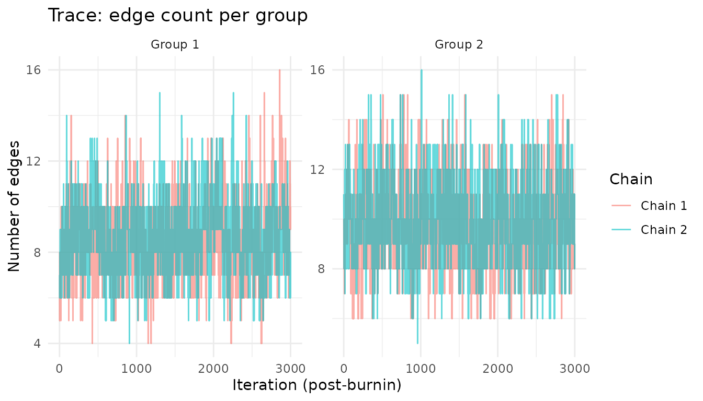
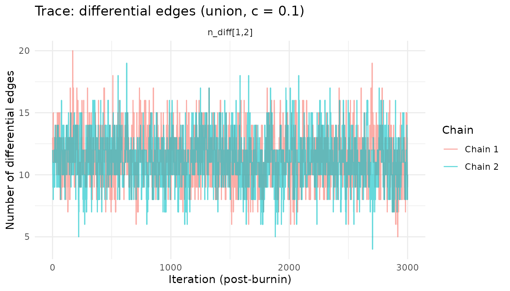
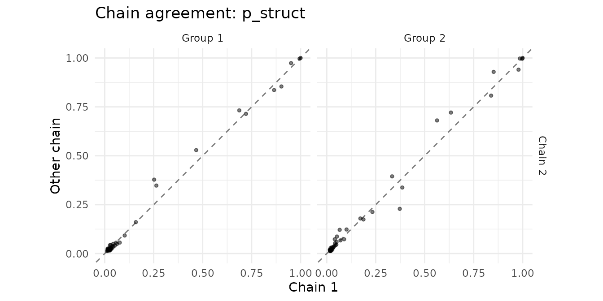
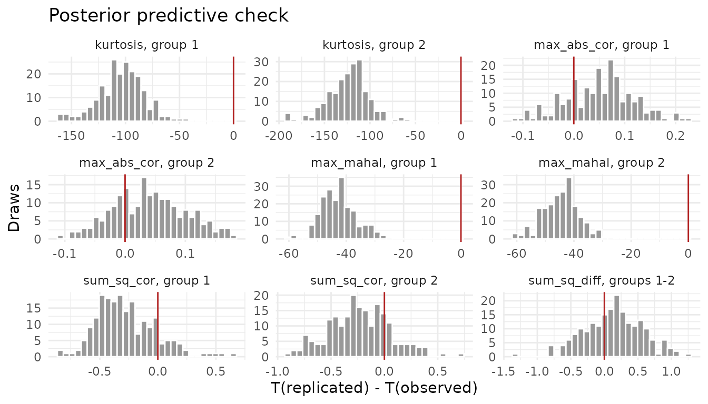

# Checking and Evaluating a Fit

Edge probabilities are only as good as the chain that produced them.
This vignette covers the checks to run before reporting a network:
convergence, Monte Carlo error, how far the data moved each edge from
its prior, summaries of differences beyond single edges, model
comparison and posterior predictive checks. Every tool here except the
posterior predictive checks works with `save_draws = FALSE`: the
samplers keep small per-iteration traces and running sums for them,
without drawing extra random numbers.

``` r

library(multiGGM)
sim <- simulate_multiggm(K = 2, p = 10, n = 150, seed = 1)
fit <- multiggm_mcmc(data_list = sim$data_list, method = "ssvs", burnin = 1000,
                     nsave = 3000, nchains = 2, seed = 1, save_draws = FALSE,
                     waic = TRUE, diff_deltas = c(0.05, 0.1, 0.15))
```

## 1. Convergence

Run several chains from different seeds.
[`mcmc_diagnostics()`](https://mljaniczek.github.io/multiGGMr/reference/mcmc_diagnostics.md)
gathers the checks in one table:

``` r

d <- mcmc_diagnostics(fit, c = 0.1)
d
#> <multiggm_diagnostics> ssvs | 2 chain(s) x 3000 post-burn-in iterations
#> 
#> Scalar summaries (flag: R-hat > 1.01 or ESS < 400 ):
#>                quantity      mean    sd  rhat ess_bulk ess_tail mcse_mean flag
#>              n_edges[1]     8.439 1.615 1.006  346.643  720.151     0.087  ess
#>               loglik[1] -2207.215 4.966 1.006  448.559  892.681     0.233     
#>              n_edges[2]     9.711 1.641 1.007  522.611  880.528     0.071     
#>               loglik[2] -2181.705 5.143 1.006  479.528 1641.924     0.237     
#>      n_diff_struct[1,2]     7.508 2.010 1.012  613.645  981.486     0.080 rhat
#>  n_diff_exceed_0.1[1,2]     9.913 1.687 1.008  703.053 1223.042     0.063     
#>   n_diff_union_0.1[1,2]    11.262 1.943 1.008  896.069 1666.698     0.065     
#>              theta[1,2]     0.360 0.233 1.009  687.320 1201.888     0.009     
#> 
#> Edge probabilities (Monte Carlo SE; n_mcse_above: edges with SE > 0.05 ):
#>             quantity max_mcse median_mcse n_mcse_above max_chain_diff
#>      group: p_struct    0.034       0.003            0          0.144
#>  group: p_exceed_0.1    0.034       0.002            0          0.137
#>       pair: p_struct    0.030       0.007            0          0.132
#>   pair: p_exceed_0.1    0.030       0.004            0          0.131
#>    pair: p_union_0.1    0.033       0.006            0          0.134
#> 
#> Acceptance rates:
#>                         step  rate flag
#>  gamma (between-model theta) 0.079     
#>         theta (within-model) 0.395     
#>                           nu 0.470     
#> 
#> 2 flag(s); see above.
```

- **Scalar summaries**: the number of edges per group, the number of
  differential edges, the log-likelihood and the graph-similarity
  parameters $`\theta`$, with rank-normalized split R-hat and bulk and
  tail effective sample sizes (Vehtari et al. 2021). Aim for R-hat below
  1.01 and ESS above about 400. Whole-graph counts are the most
  sensitive check: chains exploring different parts of graph space
  disagree on them first.
- **Edge probabilities**: R-hat is not informative for a single 0/1 edge
  indicator. Instead, each probability has a batch-means Monte Carlo SE
  (`mcse_*` columns of
  [`edge_probs()`](https://mljaniczek.github.io/multiGGMr/reference/edge_probs.md)),
  and with several chains the table reports the largest disagreement
  between chains.
- **Acceptance rates** of the Metropolis-Hastings steps, flagged outside
  (0.05, 0.95).

Flags mean “run longer” (or check the model), not that the fit is wrong.
With only 500 iterations per chain, this example flags most of the
scalar summaries; 3000 iterations clear almost all of them.

Trace plots of the same quantities:

``` r

plot_trace(fit, "edges")
```



``` r

plot_trace(fit, "diff", rule = "union", c = 0.1)
```



Edge probabilities from each chain against chain 1 should lie on the
diagonal:

``` r

plot_chain_agreement(fit, "p_struct")
```



**Monte Carlo error near a cutoff.** An edge whose probability is within
about two Monte Carlo SEs of the selection cutoff could be selected or
rejected by another run of the same length:

``` r

ep <- edge_probs(fit, scale = "pcor", c = 0.1)
pairs <- ep[ep$type == "pair", ]
summary(pairs$mcse_union_0.1)
#>     Min.  1st Qu.   Median     Mean  3rd Qu.     Max. 
#> 0.000000 0.003671 0.005518 0.009713 0.015358 0.032948
```

## 2. How much did the data say?

The priors put a probability on every edge and on every difference, and
it is not 0.5: the MRF prior favours sparse graphs, and the SSVS spike
gives $`P(|D| > c)`$ a small but nonzero prior value. A posterior
probability of 0.8 means little if the prior gave 0.6. Fit the same
model with `prior_only = TRUE`, which ignores the data, and compare:

``` r

prior <- multiggm_mcmc(data_list = sim$data_list, method = "ssvs", burnin = 1000,
                       nsave = 3000, seed = 2, save_draws = FALSE, prior_only = TRUE,
                       diff_deltas = c(0.05, 0.1, 0.15))
bf <- edge_bayes_factors(fit, prior, quantity = "p_union", c = 0.1)
head(bf[order(-bf$log10_bf), ])
#>    type group1 group2 i  j     prior posterior bayes_factor  log10_bf
#> 44 pair      1      2 8 10 0.2724148 1.0000000 32052.865947 4.5058669
#> 5  pair      1      2 2  4 0.2724148 0.9996667  6408.436510 3.8067521
#> 28 pair      1      2 7  8 0.2724148 0.9996667  6408.436510 3.8067521
#> 45 pair      1      2 9 10 0.2724148 0.8851667    20.574645 1.3133323
#> 3  pair      1      2 2  3 0.2724148 0.8793333    19.451674 1.2889570
#> 1  pair      1      2 1  2 0.2724148 0.7281667     7.153097 0.8544941
```

A Bayes factor above 10 is commonly read as strong evidence for a
difference, below 1/10 as strong evidence against (Kass & Raftery 1995).
The same comparison works for the whole network.
[`diff_count_posterior()`](https://mljaniczek.github.io/multiGGMr/reference/diff_count_posterior.md)
gives the posterior of the number of differential edges; compare it with
the same count under the prior:

``` r

post_n <- diff_count_posterior(fit, rule = "union", c = 0.1)
prior_n <- diff_count_posterior(prior, rule = "union", c = 0.1)
post_n
#> <multiggm_diff_count> groups 1 vs 2 | rule: union (c = 0.1, pcor scale)
#>   Differential edges: mean 11.3, sd 1.9, 95% interval [8, 15]
#>   P(at least one differential edge) = 1.000
prior_n
#> <multiggm_diff_count> groups 1 vs 2 | rule: union (c = 0.1, pcor scale)
#>   Differential edges: mean 12.3, sd 3.0, 95% interval [7, 18]
#>   P(at least one differential edge) = 1.000
```

The ratio of posterior to prior odds of “at least one differential edge”
is a network-level Bayes factor, but only when the prior probability is
not close to 1. With 45 edges, as here, the prior almost surely has some
difference above `c`; it becomes informative for larger `c` or larger
networks with sparser priors.

mGHS has no proper prior to sample (its diagonal prior is flat), so
`prior_only` is not available for it. Under its half-Cauchy local scales
the shrinkage weight $`w`$ has a Beta(1/2, 1/2) prior, so
$`P(w > 0.5) = 0.5`$ a priori, which is why its structural probabilities
are weak.

## 3. Beyond single edges

**Direction.** `p_up_<c>` and `p_down_<c>` split $`P(|D| > c)`$ into
$`P(D > c)`$ and $`P(D < -c)`$, with $`D = x_1 - x_2`$: whether a
connection is stronger in group 1 or in group 2.

``` r

sel <- select_diff_edges(fit, rule = "union", c = 0.1, scale = "pcor")
dirs <- merge(sel$edges, pairs[, c("i", "j", "p_up_0.1", "p_down_0.1")])
dirs
#>   i  j      prob      q_value    p_up_0.1 p_down_0.1
#> 1 2  3 0.8793333 0.0472333333 0.000000000  0.8688333
#> 2 2  4 0.9996667 0.0002222222 0.000000000  0.9978333
#> 3 7  8 0.9996667 0.0002222222 0.000000000  0.9990000
#> 4 8 10 1.0000000 0.0000000000 0.000000000  1.0000000
#> 5 9 10 0.8851667 0.0288750000 0.001166667  0.8698333
```

**Nodes.** Many small changes meeting at one node can each miss the FDR
cutoff while the node as a whole has clearly changed.
[`node_diff_summary()`](https://mljaniczek.github.io/multiGGMr/reference/node_diff_summary.md)
counts, per iteration, the differential edges at each node:

``` r

nd <- node_diff_summary(fit, rule = "union", c = 0.1)
nd[order(-nd$diff_degree), ][1:5, ]
#>   node diff_degree     p_any  rewiring rewiring_rank
#> 8    8    2.917333 1.0000000 1.4956357             1
#> 2    2    2.864833 1.0000000 0.9808248             4
#> 7    7    2.653833 1.0000000 0.9860654             3
#> 3    3    2.544333 0.9811667 0.7402874             6
#> 4    4    2.296167 0.9996667 0.7816103             5
```

`diff_degree` is the posterior mean number of differential edges at the
node, `p_any` the probability that it has at least one, and `rewiring`
the posterior mean of $`\sum_j |D_{ij}|`$, a threshold-free score.

**q-values.** Each selected edge has a Bayesian FDR q-value: the
smallest target FDR at which it would be selected. Edges with
`q_value <= alpha` are exactly those selected at `alpha`, so a single
table serves every FDR level:

``` r

sel$edges
#>   i  j      prob      q_value
#> 1 8 10 1.0000000 0.0000000000
#> 2 2  4 0.9996667 0.0002222222
#> 3 7  8 0.9996667 0.0002222222
#> 4 9 10 0.8851667 0.0288750000
#> 5 2  3 0.8793333 0.0472333333
```

## 4. Comparing models with WAIC

With `waic = TRUE`, the samplers keep per-observation sums of the
likelihood, and
[`compute_waic()`](https://mljaniczek.github.io/multiGGMr/reference/compute_waic.md)
returns the widely applicable information criterion (lower is better).
Use it to compare fits to the same data, for example two spike
variances:

``` r

fit2 <- multiggm_mcmc(data_list = sim$data_list, method = "ssvs", burnin = 500,
                      nsave = 500, seed = 1, save_draws = FALSE, waic = TRUE,
                      hyper = list(v0 = 0.05^2))
w1 <- compute_waic(fit)
#> Warning: 37 of 300 observations have p_waic > 0.4; WAIC may be unreliable.
w2 <- compute_waic(fit2)
#> Warning: 51 of 300 observations have p_waic > 0.4; WAIC may be unreliable.
w1
#> <multiggm_waic> computed from 300 observations
#>           estimate   se
#> elpd_waic  -4422.5 40.1
#> p_waic        65.0  3.7
#> waic        8844.9 80.2
# difference in elpd and its standard error, from the paired pointwise values
d <- w1$pointwise$elpd_waic - w2$pointwise$elpd_waic
c(elpd_diff = sum(d), se = sqrt(length(d) * var(d)))
#> elpd_diff        se 
#> -1.194304  2.467455
```

Judge a difference by its paired standard error, not by the standard
errors of the two WAICs. A difference smaller than about twice its
standard error is not meaningful. The warning flags observations with a
large $`p_{\mathrm{waic},i}`$ (above 0.4), which is common for graphical
models with many parameters per observation; WAIC is then only a rough
guide, and PSIS-LOO from the **loo** package (which needs saved draws)
is more reliable. WAIC costs $`O(n_k p^2)`$ per iteration, so it is off
by default.

## 5. Posterior predictive checks

Do the data look like data the fitted model would produce?
[`posterior_predictive_check()`](https://mljaniczek.github.io/multiGGMr/reference/posterior_predictive_check.md)
draws replicate datasets, one per posterior draw of the precision
matrices and with the observed group sizes, and compares discrepancy
statistics. It needs saved precision draws; thinning to about 200 keeps
them small. (`use = "mean"` gives an approximate check for fits without
draws.)

``` r

fit_d <- multiggm_mcmc(data_list = sim$data_list, method = "ssvs", burnin = 1000,
                       nsave = 200, thin = 10, seed = 1)
pc <- posterior_predictive_check(fit_d, sim$data_list, seed = 1)
pc
#> <multiggm_ppc> 200 posterior draws | edge statistic: pcor 
#> 
#>   type group1 group2   statistic observed rep_mean   ppp
#>  group      1     NA max_abs_cor    0.404    0.465 0.845
#>  group      1     NA  sum_sq_cor    1.150    1.130 0.445
#>  group      1     NA   max_mahal   24.500   25.400 0.580
#>  group      1     NA    kurtosis  122.000  118.000 0.325
#>  group      2     NA max_abs_cor    0.406    0.479 0.860
#>  group      2     NA  sum_sq_cor    1.460    1.320 0.280
#>  group      2     NA   max_mahal   26.900   25.600 0.355
#>  group      2     NA    kurtosis  126.000  119.000 0.290
#>   pair      1      2 sum_sq_diff    1.970    2.030 0.545
#> 
#> Edges with two-sided ppp < 0.05:
#>       set flagged edges
#>   group 1       0    45
#>   group 2       1    45
#>  pair 1-2       0    45
#> (ppp values concentrate near 0.5 under a correct model, so expect fewer than alpha x edges.)
```

A posterior predictive p-value (ppp) is the share of replicates with a
statistic at least as large as the observed one; values near 0 or 1 mark
a feature the model does not reproduce.

- `max_abs_cor` and `sum_sq_cor` check the strength of dependence in
  each group.
- `max_mahal` (largest squared Mahalanobis distance) and `kurtosis`
  (Mardia’s multivariate kurtosis) check for outliers and heavy tails.
  They are *realized* discrepancies, computed with the same precision
  draw for observed and replicate data.
- `sum_sq_diff` checks the total difference between groups: a ppp near 0
  means the observed groups differ more than the model implies, so the
  differences are over-shrunk.
- Per edge, the same comparison for each group’s sample partial
  correlation and for its difference between groups (`pc$edges`).

Here nothing is flagged, as it should be, since the data were simulated
from a Gaussian model. The same structure with heavy-tailed
(multivariate t) data is flagged by the outlier and kurtosis checks,
while the correlation checks still pass:

``` r

set.seed(3)
tdat <- lapply(sim$Omega_list, function(O) {
  Z <- matrix(rnorm(150 * 10), 150) %*% chol(solve(O))
  Z / sqrt(rchisq(150, 4) / 4)
})
fit_t <- multiggm_mcmc(data_list = tdat, method = "ssvs", burnin = 1000,
                       nsave = 200, thin = 10, seed = 1)
pc_t <- posterior_predictive_check(fit_t, tdat, seed = 1)
pc_t$global[pc_t$global$statistic %in% c("max_mahal", "kurtosis"), ]
#>    type group1 group2 statistic  observed  rep_mean ppp
#> 3 group      1     NA max_mahal  68.07553  25.40979   0
#> 4 group      1     NA  kurtosis 221.43193 117.74417   0
#> 7 group      2     NA max_mahal  70.18315  25.61341   0
#> 8 group      2     NA  kurtosis 242.39138 118.59520   0
plot_ppc(pc_t)
```



Heavy tails or outliers can create apparent differences between groups,
and FDR control cannot detect that. Consider a transformation (for
example a nonparanormal or rank-based transform), or check whether a few
observations drive the selected differences.

Posterior predictive p-values are conservative: under a correct model
they concentrate near 0.5, so a correct model flags fewer edges than
`alpha` suggests. Many flagged edges, or extreme global ppp values,
indicate misfit; few flags do not prove fit.

## 6. Calibration in simulations

In a simulation study the truth is known, and
[`fdr_calibration()`](https://mljaniczek.github.io/multiGGMr/reference/fdr_calibration.md)
compares the posterior expected FDR of each selection with the achieved
false discovery proportion:

``` r

fdr_calibration(fit, sim, rule = "union", c = 0.1, alpha = c(0.05, 0.1, 0.2))
#>   alpha n_selected expected_fdr achieved_fdr     power n_true
#> 1  0.05          5   0.04723333    0.2000000 0.4444444      9
#> 2  0.10          6   0.08466667    0.3333333 0.4444444      9
#> 3  0.20          9   0.18179630    0.5555556 0.4444444      9
```

Here the achieved FDR is above target, and the reason is instructive:
the first false discovery is edge (9, 10), whose true difference in
partial correlation is 0.06, but `c = 0.1` is below the sampling noise
of a difference, about $`\sqrt{2/150} \approx 0.12`$. Edges with true
differences just under `c` then pass it by chance. This is the failure
described under “Choosing c” in the edge-selection vignette; a larger
`c` or larger samples fix it. A single dataset with a handful of
selections gives a noisy achieved FDR, so average over many simulated
datasets. Achieved FDR consistently above the target means the edge
probabilities are overconfident for that rule and threshold. See the
edge-selection vignette
([`vignette("edge-selection", package = "multiGGM")`](https://mljaniczek.github.io/multiGGMr/articles/edge-selection.md))
for why the “credible interval excludes zero” rule fails this check.

## References

Vehtari, A., Gelman, A., Simpson, D., Carpenter, B. & Buerkner, P.-C.
(2021). Rank-normalization, folding, and localization: an improved R-hat
for assessing convergence of MCMC. *Bayesian Analysis*, 16(2), 667-718.

Gelman, A., Meng, X.-L. & Stern, H. (1996). Posterior predictive
assessment of model fitness via realized discrepancies. *Statistica
Sinica*, 6(4), 733-760.

Watanabe, S. (2010). Asymptotic equivalence of Bayes cross validation
and widely applicable information criterion in singular learning theory.
*Journal of Machine Learning Research*, 11, 3571-3594.

Kass, R.E. & Raftery, A.E. (1995). Bayes factors. *Journal of the
American Statistical Association*, 90(430), 773-795.
