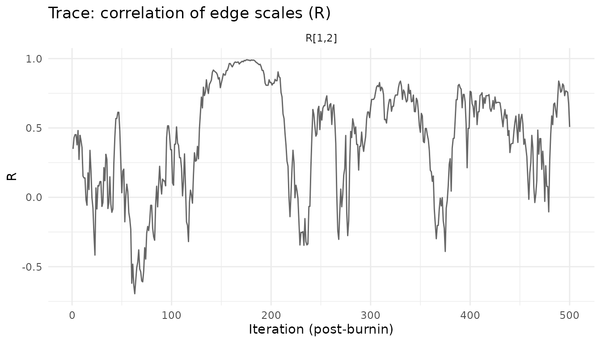

# The Multiple Graphical Horseshoe (mGHS)

## Overview

`method = "mghs"` fits the multiple graphical horseshoe of Busatto &
Stingo (2025, *JCGS*). The sampler is adapted from the authors’ code
(github.com/cbusatto/mGHS) and reproduces its draws exactly for the same
seed. Local fixes and the validation are documented in
`system.file("mghs", package = "multiGGM")`.

### Continuous shrinkage versus spike-and-slab

The G-Wishart (`"gwishart"`) and SSVS (`"ssvs"`) samplers have a binary
indicator $`g_{k,ij}`$ for every edge. Each draw says which edges are in
each graph, so the package can report posterior inclusion probabilities
([`pip_edges()`](https://mljaniczek.github.io/multiGGMr/reference/pip_edges.md))
and the probability that an edge is in one graph but not the other
([`pip_diff_edge()`](https://mljaniczek.github.io/multiGGMr/reference/pip_diff_edge.md)).
Groups borrow strength through an MRF prior on those indicators.

The mGHS has **no indicators**. Each precision entry $`\omega_{k,ij}`$
gets a horseshoe prior with a global scale $`\tau_k`$ and a local scale
$`\lambda_{ij,k}`$. Small entries are shrunk strongly towards zero but
are never exactly zero. Groups borrow strength through a $`K \times K`$
correlation matrix $`R`$ that correlates each edge’s local scales across
groups. $`R = I`$ gives independent graphical horseshoes.

So for mGHS fits:

- [`pip_edges()`](https://mljaniczek.github.io/multiGGMr/reference/pip_edges.md),
  [`pip_diff_edge()`](https://mljaniczek.github.io/multiGGMr/reference/pip_diff_edge.md),
  [`edge_counts()`](https://mljaniczek.github.io/multiGGMr/reference/edge_counts.md)
  and the plots built on them stop with an error, rather than returning
  a number with a different meaning.
- Edge strength comes from the posterior of the precision matrix or
  partial correlations ([`coef()`](https://rdrr.io/r/stats/coef.html),
  [`fitted()`](https://rdrr.io/r/stats/fitted.values.html),
  [`posterior_pcor()`](https://mljaniczek.github.io/multiGGMr/reference/posterior_pcor.md),
  [`posterior_ci()`](https://mljaniczek.github.io/multiGGMr/reference/posterior_ci.md)).
- Differential edges come from the posterior of the group difference
  $`D_{ij} = \rho_{1,ij} - \rho_{2,ij}`$
  ([`diff_summary()`](https://mljaniczek.github.io/multiGGMr/reference/diff_summary.md),
  [`select_diff_edges()`](https://mljaniczek.github.io/multiGGMr/reference/select_diff_edges.md)).

## Fitting

``` r

library(multiGGM)
sim <- simulate_multiggm(K = 2, p = 12, n = 60, perturb_prob = 0.2, seed = 1)

fit <- multiggm_mcmc(data_list = sim$data_list, method = "mghs",
                     burnin = 500, nsave = 500, seed = 1)
fit
#> <multiggm_fit>
#>   K groups: 2 
#>   p nodes : 12 
#>   Sampler : mGHS (multiple graphical horseshoe)
#>   Posterior draws: 500
summary(fit)
#> multiGGM MCMC Summary (mGHS, multiple graphical horseshoe)
#> ==========================================================
#> Groups (K): 2   |  Nodes (p): 12   |  Saved draws: 500  
#> Post-burn-in iterations: 500   |  Attempts: 2 
#> 
#> Posterior mean of R (correlation of edge scales across groups):
#>       [,1]  [,2]
#> [1,] 1.000 0.418
#> [2,] 0.418 1.000
#> 
#> Posterior mean global shrinkage tau per group:
#> [1] 0.0022 0.0014
#> 
#> No edge-inclusion indicators: use select_diff_edges() or diff_summary()
#> for differential edges and posterior_ci() for edge strength.
```

The trace of $`R_{12}`$ replaces the $`\theta`$ trace of the MRF
samplers:

``` r

plot_trace(fit, "theta")
#> Ignoring unknown labels:
#> • colour : "Chain"
```



## Differential edges and Bayesian FDR

[`diff_summary()`](https://mljaniczek.github.io/multiGGMr/reference/diff_summary.md)
gives one row per edge: the posterior mean and standard deviation of
$`D`$, a credible interval, and $`P(|D| > c)`$ for each threshold $`c`$.

``` r

ds <- diff_summary(fit, scale = "pcor", deltas = c(0.05, 0.1))
head(ds[order(-ds$p_exceed_0.1), ])
#>     i  j       mean        sd         lower     median       upper
#> 6   3  4 -0.3527970 0.1249140 -0.5795079298 -0.3584738 -0.06939857
#> 65 10 12  0.3149062 0.1486431  0.0007256321  0.3302036  0.56660615
#> 1   1  2 -0.1994676 0.1791820 -0.5020627843 -0.1989438  0.17036425
#> 25  4  8  0.1830435 0.1415300 -0.0453670684  0.1937620  0.45110836
#> 66 11 12 -0.1210339 0.1649079 -0.4478402745 -0.1119946  0.21586969
#> 20  5  7 -0.1113987 0.1591270 -0.3962534596 -0.1102332  0.20513381
#>    excludes_zero p_sign p_exceed_0.05 p_exceed_0.1
#> 6           TRUE  0.994         0.984        0.968
#> 65          TRUE  0.976         0.926        0.892
#> 1          FALSE  0.860         0.878        0.774
#> 25         FALSE  0.894         0.808        0.718
#> 66         FALSE  0.780         0.758        0.616
#> 20         FALSE  0.748         0.750        0.606
```

[`select_diff_edges()`](https://mljaniczek.github.io/multiGGMr/reference/select_diff_edges.md)
selects the largest set of edges whose posterior expected false
discovery rate is at most `alpha`:

``` r

sel <- select_diff_edges(fit, alpha = 0.05, delta = 0.1)
sel
#> <multiggm_diff_selection>
#>   Groups 1 vs 2, rule: magnitude (P(|D| > 0.1), pcor scale)
#>   Selected 1 edges at target FDR 0.05 (posterior expected FDR 0.032)
#>   i j  prob      mean
#> 1 3 4 0.968 -0.352797
```

### Calibration caveat: do not use “the interval excludes zero”

It is tempting to call an edge differential when its credible interval
for $`D`$ excludes zero, i.e. to run Bayesian FDR on
$`\max\{P(D > 0), P(D < 0)\}`$ (the `p_sign` column). **Under a
continuous prior this is badly anti-conservative.** $`P(D = 0) = 0`$, so
`p_sign` is not the probability that the edge differs. An edge with the
*same* true value in both groups still has an estimated $`D`$ of
sampling-noise size, and with large $`n`$ its posterior is concentrated
enough to give `p_sign` near 1. In a simulation with p = 100 and n =
1000 per group, Bayesian FDR on `p_sign` gave an achieved FDR of about
0.50 at a nominal 0.05; the false calls were edges with identical true
values whose $`|D|`$ was about 0.04 to 0.08.

The same applies to the SSVS sampler (its spike is a normal
distribution) and to G-Wishart edges present in both groups.

Use $`P(|D| > \delta)`$ with a $`\delta`$ that is meaningful for your
problem. The FDR is then controlled for the hypothesis
$`|D_{ij}| > \delta`$: a true difference smaller than $`\delta`$ counts
as a null. For the indicator-based samplers, `rule = "structural"`
($`P(g_{1,ij} \ne g_{2,ij})`$) is also available.

## Memory, thinning and summary-only fits

Saved draws take $`8 p^2 K \cdot`$`nsave` bytes per chain: 160 MB at p =
100, K = 2 and 1000 draws. Two ways to reduce this:

- `thin`: the sampler runs every iteration but saves every `thin`-th
  draw.
- `save_draws = FALSE`: no draws are kept. The sampler keeps running
  sums over **every** post-burn-in iteration of the posterior means and
  of $`D`$ (mean, SD, $`P(D > 0)`$, $`P(D < 0)`$ and $`P(|D| > c)`$ for
  the thresholds in `diff_deltas`).
  [`coef()`](https://rdrr.io/r/stats/coef.html),
  [`fitted()`](https://rdrr.io/r/stats/fitted.values.html),
  [`diff_summary()`](https://mljaniczek.github.io/multiGGMr/reference/diff_summary.md)
  and
  [`select_diff_edges()`](https://mljaniczek.github.io/multiGGMr/reference/select_diff_edges.md)
  use these; credible intervals and other draw-based functions are
  unavailable.

``` r

lean <- multiggm_mcmc(data_list = sim$data_list, method = "mghs",
                      burnin = 500, nsave = 500, nchains = 2, seed = 2,
                      save_draws = FALSE, diff_deltas = c(0.05, 0.1))
select_diff_edges(lean, alpha = 0.05, delta = 0.1)
#> <multiggm_diff_selection>
#>   Groups 1 vs 2, rule: magnitude (P(|D| > 0.1), pcor scale)
#>   Selected 1 edges at target FDR 0.05 (posterior expected FDR 0.019)
#>   i j  prob       mean
#> 1 3 4 0.981 -0.3619992
```

Chains are pooled by default in
[`diff_summary()`](https://mljaniczek.github.io/multiGGMr/reference/diff_summary.md)
and
[`select_diff_edges()`](https://mljaniczek.github.io/multiGGMr/reference/select_diff_edges.md).

## Stuck chains and run time

The sampler inherits a guard from the authors’ code: if a local-scale
update would use parameters above $`10^6`$, the chain is declared stuck.
This happens when the global scale $`\tau_k`$ collapses or $`R`$
approaches a singular matrix, and it is more frequent for small, sparse
problems. With p = 12 and n = 150 per group, 5 of 6 chains got stuck
within 2,000 iterations, in both the authors’ code and this package.
With n = 50, none of 6 did, and in a simulation study at p = 100 and n =
1000 all 100 fits completed, some after a restart. The package also
checks every scale draw for non-finite values and caps every rejection
loop, so a chain can no longer hang. A stuck chain is restarted from
scratch (up to `max_attempts`, default 3) and the number of attempts is
reported in [`summary()`](https://rdrr.io/r/base/summary.html). If all
attempts fail,
[`multiggm_mcmc()`](https://mljaniczek.github.io/multiGGMr/reference/multiggm_mcmc.md)
stops with an error.

Run time per iteration depends strongly on the data, not only on $`p`$:
in our runs it ranged from about 10 to over 100 ms per iteration for
$`p \le 50`$.

## References

Busatto, C. & Stingo, F.C. (2025). Inference of multiple
high-dimensional networks with the Graphical Horseshoe prior. *Journal
of Computational and Graphical Statistics*.
<doi:10.1080/10618600.2024.2435480>

Busatto, C. & Stingo, F.C. (2025). The multiple graphical horseshoe: an
application to breast cancer data. In *SIS 2025*, 435-440. Springer.

Li, Y., Craig, B.A. & Bhadra, A. (2019). The graphical horseshoe
estimator for inverse covariance matrices. *Journal of Computational and
Graphical Statistics*, 28(3), 747-757.

Newton, M.A., Noueiry, A., Sarkar, D. & Ahlquist, P. (2004). Detecting
differential gene expression with a semiparametric hierarchical mixture
method. *Biostatistics*, 5(2), 155-176.
