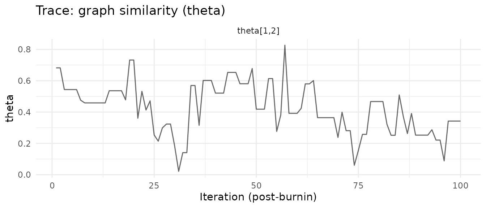
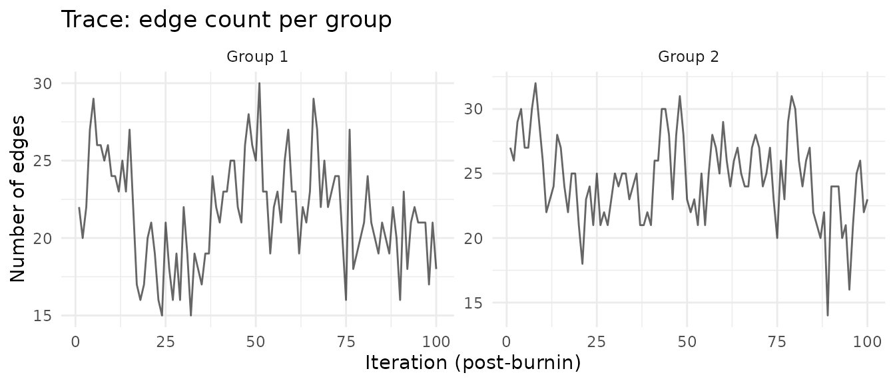
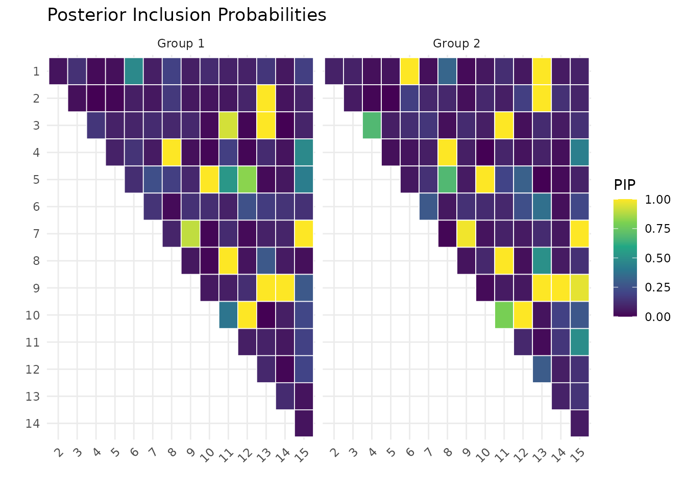
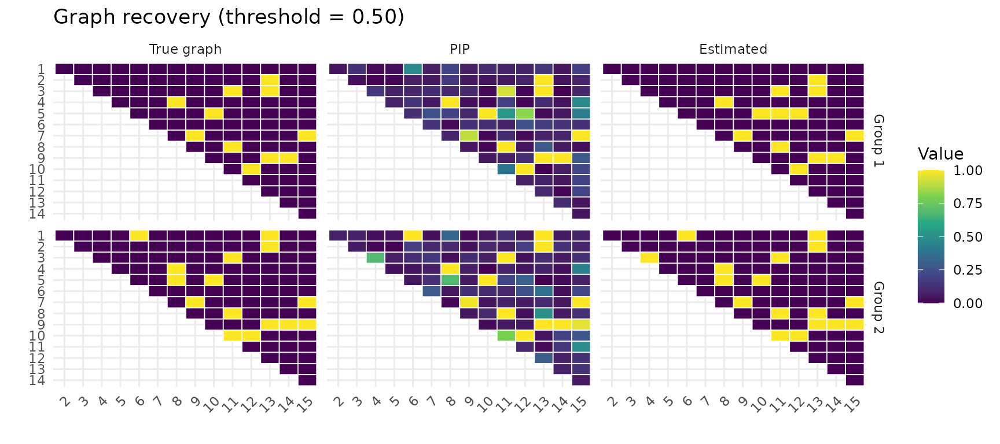
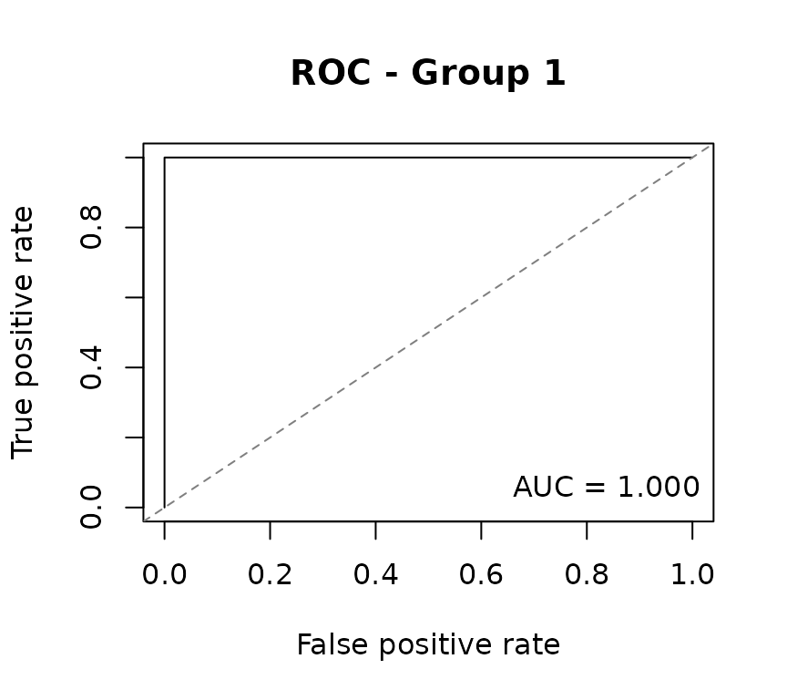
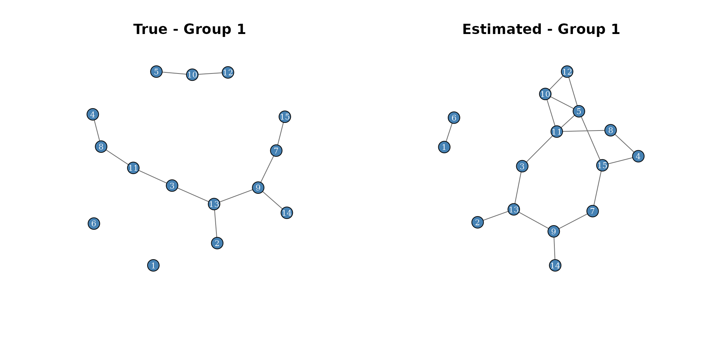
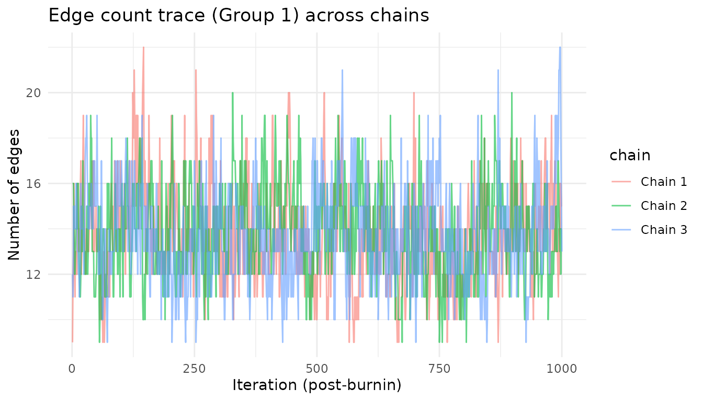
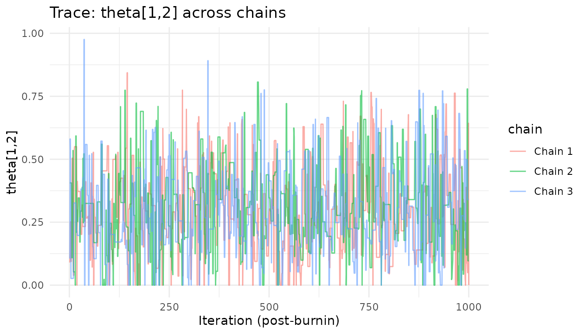

# Getting Started with multiGGM

## Introduction

The **multiGGM** package implements the Bayesian method of Peterson,
Stingo & Vannucci (2015, *JASA*) for joint inference of multiple
Gaussian graphical models (GGMs). Given data from $`K`$ groups, the
method simultaneously estimates group-specific precision matrices
$`\Omega_k`$ and their associated conditional independence graphs
$`G_k`$, while borrowing strength across groups through a Markov random
field (MRF) prior.

This vignette walks through:

1.  Simulating multi-group data with known graph structure
2.  Fitting the model with
    [`multiggm_mcmc()`](https://mljaniczek.github.io/multiGGMr/reference/multiggm_mcmc.md)
3.  Checking convergence
4.  Extracting and interpreting results
5.  Comparing estimated graphs to ground truth
6.  Running and summarizing multiple MCMC chains

## 1. Simulate data

We generate data from two groups with $`p = 15`$ variables and
$`n = 100`$ observations each, using a random graph structure that
differs slightly between the groups.

``` r

library(multiGGM)

sim <- simulate_multiggm(
  K = 2, p = 15, n = 100,
  graph_type = "random",
  perturb_prob = 0.1,
  seed = 42
)

cat("True edge counts:\n")
#> True edge counts:
for (k in 1:sim$K) {
  adj_k <- sim$adj_list[[k]]
  cat(sprintf("  Group %d: %d edges\n", k, sum(adj_k[upper.tri(adj_k)])))
}
#>   Group 1: 11 edges
#>   Group 2: 15 edges
```

## 2. Fit the model

We pass raw data matrices directly. The function computes cross-product
matrices internally after column-centering.

``` r

fit <- multiggm_mcmc(
  data_list = sim$data_list,
  burnin = 200,
  nsave = 100,
  thin = 1,
  seed = 123
)
```

``` r

fit
#> <multiggm_fit>
#>   K groups: 2 
#>   p nodes : 15 
#>   Posterior draws: 100
```

## 3. Check convergence

### Summary

The [`summary()`](https://rdrr.io/r/base/summary.html) method reports
acceptance rates and edge counts. Acceptance rates between 20-60% are
generally healthy.

``` r

summary(fit, pip_threshold = .3)
#> multiGGM MCMC Summary
#> =====================
#> Groups (K): 2   |  Nodes (p): 15   |  Posterior draws: 100 
#> 
#> Acceptance rates:
#>   gamma (edge toggle): 1.0% 
#>   theta (within-model): 47.2% 
#>   nu (edge log-odds): 48.9% 
#> 
#> Selected edges (PIP >= 0.3 ):
#>   Group 1 : 17 edges
#>   Group 2 : 22 edges
#> 
#> Graph similarity (theta):
#>   theta[1,2]: mean = 0.422, P(nonzero) = 100.0%
```

### Trace plots

Trace plots help assess mixing. The theta trace shows the graph
similarity parameter – values above zero indicate the model is borrowing
strength across groups.

``` r

plot(fit, type = "trace_theta")
#> Ignoring unknown labels:
#> • colour : "Chain"
```



``` r

plot(fit, type = "trace_edges")
#> Ignoring unknown labels:
#> • colour : "Chain"
```



## 4. Extract results

### Posterior inclusion probabilities (PIP)

PIPs indicate how often each edge was included across posterior samples.
Higher PIP = stronger evidence for that edge.

``` r

pip <- pip_edges(fit)
```

``` r

plot(fit, type = "pip")
```



### Estimated precision and partial correlations

The [`coef()`](https://rdrr.io/r/stats/coef.html) method returns
posterior mean precision matrices, while
[`fitted()`](https://rdrr.io/r/stats/fitted.values.html) returns
posterior mean partial correlations.

``` r

omega_hat <- coef(fit)
cat("Posterior mean precision (Group 1, first 5x5 block):\n")
#> Posterior mean precision (Group 1, first 5x5 block):
round(omega_hat[[1]][1:5, 1:5], 3)
#>        [,1]   [,2]   [,3]   [,4]   [,5]
#> [1,]  1.358 -0.001  0.011  0.006  0.005
#> [2,] -0.001  1.077 -0.002  0.000 -0.001
#> [3,]  0.011 -0.002  1.088 -0.014 -0.001
#> [4,]  0.006  0.000 -0.014  0.916 -0.009
#> [5,]  0.005 -0.001 -0.001 -0.009  1.257
```

``` r

pcor_hat <- fitted(fit)
cat("Posterior mean partial correlations (Group 1, first 5x5 block):\n")
#> Posterior mean partial correlations (Group 1, first 5x5 block):
round(pcor_hat[[1]][1:5, 1:5], 3)
#>        [,1]  [,2]   [,3]   [,4]   [,5]
#> [1,]  1.000 0.001 -0.010 -0.005 -0.004
#> [2,]  0.001 1.000  0.002  0.000  0.001
#> [3,] -0.010 0.002  1.000  0.014  0.001
#> [4,] -0.005 0.000  0.014  1.000  0.008
#> [5,] -0.004 0.001  0.001  0.008  1.000
```

### Credible intervals

``` r

pcor_draws <- posterior_pcor(fit)
ci <- posterior_ci(pcor_draws)

# Example: 95% CI for edge (1,2) in group 1
cat(sprintf("pcor[1,2] Group 1: %.3f (%.3f, %.3f)\n",
            ci$median[1, 2, 1], ci$lower[1, 2, 1], ci$upper[1, 2, 1]))
#> pcor[1,2] Group 1: -0.000 (-0.000, 0.003)
```

## 5. Compare to ground truth

### Visual comparison

[`plot_recovery()`](https://mljaniczek.github.io/multiGGMr/reference/plot_recovery.md)
shows the true graph, PIP heatmap, and thresholded estimate
side-by-side.

``` r

cm <- plot_recovery(fit, sim$adj_list, pip_threshold = 0.5)
```



### Confusion metrics

``` r

for (k in seq_along(cm)) {
  cat(sprintf("Group %d: TP=%d, FP=%d, FN=%d, TN=%d, TPR=%.2f, FPR=%.2f\n",
              k, cm[[k]]$TP, cm[[k]]$FP, cm[[k]]$FN, cm[[k]]$TN,
              cm[[k]]$TPR, cm[[k]]$FPR))
}
#> Group 1: TP=11, FP=2, FN=0, TN=92, TPR=1.00, FPR=0.02
#> Group 2: TP=15, FP=2, FN=0, TN=88, TPR=1.00, FPR=0.02
```

### ROC curve

The ROC curve evaluates edge selection across all possible thresholds.

``` r

roc1 <- roc_auc(pip[, , 1], sim$adj_list[[1]])
plot_roc(roc1, main = "ROC - Group 1")
```



## 6. Network visualization

We can visualize the estimated graph as a network.

``` r

par(mfrow = c(1, 2))
plot_network(sim$adj_list[[1]], main = "True - Group 1", vertex_size = 12)
est_adj <- (pip[, , 1] >= 0.3) * 1L
plot_network(est_adj, main = "Estimated - Group 1", vertex_size = 12)
```



## 7. Differential edges

For $`K = 2`$ groups, we can identify edges that differ between groups.

``` r

pip_diff <- pip_diff_edge(fit)
cat("Edges with P(differential) > 0.5:",
    sum(pip_diff[upper.tri(pip_diff)] > 0.5), "\n")
#> Edges with P(differential) > 0.5: 6
```

``` r

pcor_draws <- posterior_pcor(fit)
diff_prob <- diff_prob_pcor(pcor_draws, delta = 0.1)
cat("Edges with P(|pcor diff| > 0.1) > 0.5:",
    sum(diff_prob[upper.tri(diff_prob)] > 0.5), "\n")
#> Edges with P(|pcor diff| > 0.1) > 0.5: 17
```

### Bayesian FDR on differential edges

[`select_diff_edges()`](https://mljaniczek.github.io/multiGGMr/reference/select_diff_edges.md)
turns a per-edge probability of a real difference into a selection with
posterior expected FDR at most `alpha`. With `rule = "structural"` the
probability is $`P(g_{1,ij} \ne g_{2,ij})`$; with `rule = "magnitude"`
it is $`P(|\rho_{1,ij} - \rho_{2,ij}| > \delta)`$.

``` r

select_diff_edges(fit, rule = "structural", alpha = 0.1)
#> <multiggm_diff_selection>
#>   Groups 1 vs 2, rule: structural, decision: bfdr
#>   Selected 0 edges at target FDR 0.1 (posterior expected FDR 0.000)
select_diff_edges(fit, rule = "magnitude", delta = 0.1, alpha = 0.1)
#> <multiggm_diff_selection>
#>   Groups 1 vs 2, rule: magnitude (c = 0.1, pcor scale), decision: bfdr
#>   Selected 14 edges at target FDR 0.1 (posterior expected FDR 0.094)
#>     i  j prob q_value       mean
#> 1   4  8 1.00   0.000 -1.0378726
#> 2   3 11 1.00   0.000  0.6238238
#> 3  10 12 1.00   0.000 -0.9582806
#> 4   1 13 1.00   0.000 -0.3287330
#> 5   2 13 1.00   0.000  0.8208254
#> 6   9 13 1.00   0.000 -0.6333491
#> 7   9 14 1.00   0.000  0.7401484
#> 8   1  6 0.99   0.003 -0.3989599
#> 9   3 13 0.99   0.003  0.3223887
#> 10  7 15 0.99   0.003  0.3229436
```

Avoid calling differences by whether a credible interval for the
difference excludes zero.
[`vignette("edge-selection")`](https://mljaniczek.github.io/multiGGMr/articles/edge-selection.md)
explains the structural, magnitude and union rules, when each applies,
and how to choose `c`; all of them are available without saving draws
(`save_draws = FALSE`).
[`vignette("diagnostics")`](https://mljaniczek.github.io/multiGGMr/articles/diagnostics.md)
covers convergence checks, Monte Carlo error, prior-versus-posterior
comparisons, node-level summaries and WAIC.

## 8. Running multiple chains

Running multiple MCMC chains from different starting points is important
for assessing convergence. The
[`multiggm_mcmc()`](https://mljaniczek.github.io/multiGGMr/reference/multiggm_mcmc.md)
function supports this via the `nchains` argument. Chains can be run in
parallel with `parallel = TRUE`. The multi-chain tools work the same for
every sampler; to keep this vignette quick we use the faster SSVS
sampler here, and short chains (real analyses need far longer runs;
check them with
[`mcmc_diagnostics()`](https://mljaniczek.github.io/multiGGMr/reference/mcmc_diagnostics.md)).

### Fitting multiple chains

``` r

fit_mc <- multiggm_mcmc(
  data_list = sim$data_list,
  method    = "ssvs",
  burnin    = 1000,
  nsave     = 1000,
  nchains   = 3,
  parallel  = TRUE,
  ncores    = 2,
  seed      = 42
)
```

The result is a `multiggm_fit_list` object containing all chains:

``` r

fit_mc
#> <multiggm_fit_list>
#>   Chains: 3 
#>   K groups: 2
```

### Accessing individual chains

Each chain is a full `multiggm_fit` object. Access them via `$chains`:

``` r

# Summary of chain 1
summary(fit_mc$chains[[1]], pip_threshold = 0.3)
#> multiGGM MCMC Summary
#> =====================
#> Groups (K): 2   |  Nodes (p): 15   |  Posterior draws: 1000 
#> 
#> Acceptance rates:
#>   gamma (edge toggle): 6.1% 
#>   theta (within-model): 34.6% 
#>   nu (edge log-odds): 44.4% 
#> 
#> Selected edges (PIP >= 0.3 ):
#>   Group 1 : 12 edges
#>   Group 2 : 16 edges
#> 
#> Graph similarity (theta):
#>   theta[1,2]: mean = 0.296, P(nonzero) = 95.6%
```

Most utility functions accept a `chain` argument to select which chain
to analyze:

``` r

# PIPs from chain 1 vs chain 2
pip_c1 <- pip_edges(fit_mc, chain = 1)
pip_c2 <- pip_edges(fit_mc, chain = 2)

idx <- upper.tri(pip_c1[, , 1])
cat(sprintf("PIP correlation between chain 1 and 2 (Group 1): %.3f\n",
            cor(pip_c1[, , 1][idx], pip_c2[, , 1][idx])))
#> PIP correlation between chain 1 and 2 (Group 1): 0.991
```

### Comparing trace plots across chains

Overlaying trace plots from multiple chains is one of the most effective
visual convergence diagnostics. Chains that have converged will mix and
overlap, while chains stuck in different modes will show persistent
separation.

``` r

library(ggplot2)

# Build a combined edge-count trace from all chains
trace_df <- do.call(rbind, lapply(seq_len(fit_mc$nchains), function(ch) {
  ec <- edge_counts(fit_mc, chain = ch)
  data.frame(
    iteration = seq_len(nrow(ec)),
    edges     = ec[, 1],
    chain     = paste("Chain", ch),
    stringsAsFactors = FALSE
  )
}))

ggplot(trace_df, aes(x = iteration, y = edges, color = chain)) +
  geom_line(alpha = 0.6) +
  labs(title = "Edge count trace (Group 1) across chains",
       x = "Iteration (post-burnin)", y = "Number of edges") +
  theme_minimal()
```



``` r

# Overlay theta traces from all chains
theta_df <- do.call(rbind, lapply(seq_len(fit_mc$nchains), function(ch) {
  data.frame(
    iteration = seq_len(dim(fit_mc$chains[[ch]]$Theta_save)[3]),
    theta     = fit_mc$chains[[ch]]$Theta_save[1, 2, ],
    chain     = paste("Chain", ch),
    stringsAsFactors = FALSE
  )
}))

ggplot(theta_df, aes(x = iteration, y = theta, color = chain)) +
  geom_line(alpha = 0.6) +
  labs(title = "Trace: theta[1,2] across chains",
       x = "Iteration (post-burnin)", y = "theta[1,2]") +
  theme_minimal()
```



### Pooling results across chains

Posterior summaries pool all chains by default: `pip_edges(fit_mc)`,
[`posterior_pcor()`](https://mljaniczek.github.io/multiGGMr/reference/posterior_pcor.md),
[`posterior_precision()`](https://mljaniczek.github.io/multiGGMr/reference/posterior_precision.md),
[`coef()`](https://rdrr.io/r/stats/coef.html),
[`fitted()`](https://rdrr.io/r/stats/fitted.values.html),
[`diff_summary()`](https://mljaniczek.github.io/multiGGMr/reference/diff_summary.md)
and
[`select_diff_edges()`](https://mljaniczek.github.io/multiGGMr/reference/select_diff_edges.md)
use every chain’s draws, and `chain = i` restricts them to one chain.
`summary(fit_mc)` reports each chain, the pooled edge counts and the
largest between-chain difference in PIPs, and
`plot(fit_mc, type = "trace_edges")` overlays the chains.

``` r

summary(fit_mc, pip_threshold = 0.5)
#> multiGGM MCMC Summary: 3 chains, K = 2
#> ==========================================
#> Pooled selected edges (PIP >= 0.5 ):
#>   Group 1: 10 edges
#>   Group 2: 13 edges
#> 
#> Largest difference in PIP between chains:
#>   Group 1: 0.240
#>   Group 2: 0.197
#> 
#> --- Chain 1 ---
#> multiGGM MCMC Summary
#> =====================
#> Groups (K): 2   |  Nodes (p): 15   |  Posterior draws: 1000 
#> 
#> Acceptance rates:
#>   gamma (edge toggle): 6.1% 
#>   theta (within-model): 34.6% 
#>   nu (edge log-odds): 44.4% 
#> 
#> Selected edges (PIP >= 0.5 ):
#>   Group 1 : 10 edges
#>   Group 2 : 13 edges
#> 
#> Graph similarity (theta):
#>   theta[1,2]: mean = 0.296, P(nonzero) = 95.6%
#> 
#> 
#> --- Chain 2 ---
#> multiGGM MCMC Summary
#> =====================
#> Groups (K): 2   |  Nodes (p): 15   |  Posterior draws: 1000 
#> 
#> Acceptance rates:
#>   gamma (edge toggle): 6.1% 
#>   theta (within-model): 34.0% 
#>   nu (edge log-odds): 43.7% 
#> 
#> Selected edges (PIP >= 0.5 ):
#>   Group 1 : 11 edges
#>   Group 2 : 13 edges
#> 
#> Graph similarity (theta):
#>   theta[1,2]: mean = 0.312, P(nonzero) = 95.3%
#> 
#> 
#> --- Chain 3 ---
#> multiGGM MCMC Summary
#> =====================
#> Groups (K): 2   |  Nodes (p): 15   |  Posterior draws: 1000 
#> 
#> Acceptance rates:
#>   gamma (edge toggle): 6.4% 
#>   theta (within-model): 33.7% 
#>   nu (edge log-odds): 43.1% 
#> 
#> Selected edges (PIP >= 0.5 ):
#>   Group 1 : 10 edges
#>   Group 2 : 14 edges
#> 
#> Graph similarity (theta):
#>   theta[1,2]: mean = 0.299, P(nonzero) = 94.9%
```

To work with the raw draws yourself, concatenate the saved arrays along
the iteration dimension:

``` r

# Pool precision draws across all chains
pool_C <- abind::abind(
  lapply(fit_mc$chains, function(ch) ch$C_save),
  along = 4
)
cat(sprintf("Pooled draws: %d (from %d chains x %d draws each)\n",
            dim(pool_C)[4], fit_mc$nchains, dim(fit_mc$chains[[1]]$C_save)[4]))
#> Pooled draws: 3000 (from 3 chains x 1000 draws each)

# Pool adjacency draws for combined PIPs
pool_adj <- abind::abind(
  lapply(fit_mc$chains, function(ch) ch$adj_save),
  along = 4
)
pip_pooled <- apply(pool_adj, c(1, 2, 3), mean)

cat(sprintf("Pooled edges (PIP > 0.5, Group 1): %d\n",
            sum(pip_pooled[, , 1][upper.tri(pip_pooled[, , 1])] > 0.5)))
#> Pooled edges (PIP > 0.5, Group 1): 10
```

### Summary of multi-chain functions

| Task | Code |
|----|----|
| Fit multiple chains | `multiggm_mcmc(..., nchains = 4, parallel = TRUE)` |
| Access chain $`i`$ | `fit$chains[[i]]` |
| Summary of all chains | `summary(fit)` |
| Overlaid trace plots | `plot(fit, type = "trace_edges")` |
| PIPs, pooled / from chain $`i`$ | `pip_edges(fit)` / `pip_edges(fit, chain = i)` |
| Partial correlations, pooled / chain $`i`$ | `posterior_pcor(fit)` / `posterior_pcor(fit, chain = i)` |
| Precision matrices, pooled / chain $`i`$ | `posterior_precision(fit)` / `posterior_precision(fit, chain = i)` |
| Edge counts (a per-chain trace) | `edge_counts(fit, chain = i)` |
| Raw pooled draws | `abind::abind(lapply(fit$chains, \(ch) ch$C_save), along = 4)` |

## References

Peterson, C.B., Stingo, F.C. & Vannucci, M. (2015). Bayesian inference
of multiple Gaussian graphical models. *Journal of the American
Statistical Association*, 110(509), 159-174.
